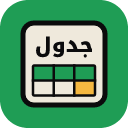

<p align="center">
  
</p>

<h1 align="center">جدول</h1>

<p align="center">
  <b>برنامج جداول بيانات عربي، مجاني ومفتوح المصدر</b><br>
  An Arabic spreadsheet, free and open source
</p>

<p align="center">
  <a href="https://github.com/nasserfq/jadwal/releases/latest"><b>⬇︎ تنزيل · Download</b></a>
  &nbsp;·&nbsp; macOS &nbsp;·&nbsp; Windows &nbsp;·&nbsp; Linux
</p>

---

<div dir="rtl">

## عن جدول

جدول برنامج جداول بيانات مصمم للعربية أولًا: الواجهة عربية ومن اليمين إلى اليسار، والأوراق الجديدة تبدأ من اليمين إلى اليسار، فيكون العمود A على اليمين.

- **واجهة عربية بالكامل** من اليمين إلى اليسار، مع خيار الإنجليزية ولغات أخرى.
- **أوراق من اليمين إلى اليسار** افتراضيًا.
- **ملفات Excel** ‏(‎.xlsx‎) وCSV فتحًا وحفظًا، مع الصيغ والمخططات والجداول والتنسيق الشرطي.

## التثبيت

| النظام | الملف | الخطوات |
|---|---|---|
| macOS ‏(Apple Silicon وIntel، الإصدار 11 فأحدث) | `jadwal-…-macos-universal.dmg` | افتح الملف واسحب جدول إلى «التطبيقات». موقّع وموثَّق من Apple. |
| Windows | `jadwal-…-windows-x64-portable.zip` | فك الضغط وشغّل `Jadwal.exe`. |
| Linux | `jadwal-…-linux-x86_64.tar.gz` | فك الضغط وشغّل `jadwal`. |

التحديث تلقائي: عند صدور إصدار جديد يعرض جدول «تحديث وإعادة تشغيل»، وتبقى إعداداتك وملفاتك كما هي.

## التحكم بجدول من الذكاء الاصطناعي (MCP)

جدول جاهز للذكاء الاصطناعي: يأتي مع خادم [MCP](https://modelcontextprotocol.io)، وهو معيار مفتوح تستخدمه تطبيقات الذكاء الاصطناعي لتشغيل البرامج. بعد ربطه تطلب بكلامك، مثلًا «اعمل جدولًا بمصروفات الشهر، واجمع كل عمود، وأضف مخططًا، واحفظه Excel»، فينفّذه الذكاء الاصطناعي في جدول خطوة بخطوة: إدخال القيم والصيغ والتنسيق والفرز والمخططات وقراءة الخلايا والحفظ بصيغة Excel أو CSV أو PDF.

يعمل مع أي تطبيق يدعم MCP، مثل Claude ‏(التطبيق وClaude Code)، وCodex من OpenAI، وCursor، وVS Code مع Copilot، وGemini CLI، وLM Studio ‏(نماذج تعمل على جهازك دون إنترنت). الخادم مجاني ويعمل على جهازك، أما الذكاء الاصطناعي فمن التطبيق الذي تختاره وبحسب اشتراكك فيه.

**الطريقة الأسهل، بنقرة:** في جدول افتح تبويب «أتمتة» ← «ربط مع الذكاء الاصطناعي». تظهر تطبيقات الذكاء الاصطناعي المثبتة على جهازك، مثل Claude وClaude Code وCodex وCursor وVS Code وWindsurf وGemini CLI وLM Studio، فاضغط «ربط» بجانب التطبيق ثم أعد تشغيله. ولأي تطبيق آخر يدعم MCP اضغط «نسخ الإعداد» والصقه في إعداداته.

اذكر **jadwal** في طلبك، مثل «استخدم أدوات jadwal لـ…»، لأن «جدول» كلمة عامة أيضًا، فقد يفتح بعض التطبيقات (مثل Codex) برنامج Excel بدلًا منه.

على Mac يمكنك أيضًا تنزيل ملف `jadwal-claude-extension-macos.mcpb` من [صفحة الإصدارات](https://github.com/nasserfq/jadwal/releases/latest) وفتحه، فيعرض تطبيق Claude نافذة «تثبيت» ويضيف جدول بنقرة.

**الإعداد اليدوي (إن أردت):**

**1. مكان الخادم:** يُثبَّت مع جدول ويُحدَّث معه.

| النظام | المسار |
|---|---|
| macOS | `/Applications/جدول.app/Contents/MacOS/jadwal-cli` |
| Windows | `jadwal-cli.exe` في مجلد جدول، بجانب `Jadwal.exe` |
| Linux | `jadwal-cli` في مجلد جدول، بجانب `jadwal` |

**2. أضفه إلى تطبيق الذكاء الاصطناعي:**

- **تطبيق Claude:** الإعدادات ← «Developer» ← «Edit Config»، ثم أضف ما يلي إلى الملف `claude_desktop_config.json` وأعد تشغيل Claude:

<div dir="ltr">

```json
{
  "mcpServers": {
    "jadwal": {
      "command": "/Applications/جدول.app/Contents/MacOS/jadwal-cli",
      "args": ["mcp"]
    }
  }
}
```

</div>

- في Windows ضع مسار `jadwal-cli.exe` بدل المسار السابق، مع مضاعفة الشرطة المائلة، مثل `"C:\\Users\\اسمك\\Jadwal\\jadwal-cli.exe"`.
- **Cursor وGemini CLI وLM Studio** وأغلب التطبيقات الأخرى: الإعداد نفسه (`mcpServers`) في ملف MCP الخاص بكل تطبيق (`~/.cursor/mcp.json`، ‏`~/.gemini/settings.json`، ‏`mcp.json` في LM Studio).
- **Claude Code:** <code dir="ltr">claude mcp add jadwal -- "/Applications/جدول.app/Contents/MacOS/jadwal-cli" mcp</code>
- **Codex:** <code dir="ltr">codex mcp add jadwal -- "/Applications/جدول.app/Contents/MacOS/jadwal-cli" mcp</code>

بهذا يعمل الذكاء الاصطناعي على الملفات في الخلفية دون نافذة، ثم يحفظها حيث تطلب.

**التحكم بنافذة جدول المفتوحة (اختياري):** لتشاهد الذكاء الاصطناعي يعمل في النافذة نفسها، شغّل جدول مع منفذ تحكم، واجعل `args` هي <code dir="ltr">["mcp", "--connect", "7981"]</code>:

<div dir="ltr">

```sh
"/Applications/جدول.app/Contents/MacOS/GridCraft" --control 7981   # macOS
Jadwal.exe --control 7981                                   # Windows
./jadwal --control 7981                                     # Linux
```

</div>

منفذ التحكم محلي فقط ومحمي بمفتاح سري يكتبه جدول في مجلد إعداداتك، فلا يصل إليه أحد من الشبكة.

## ما أضافه ناصر القحطاني إلى GridCraft

- ترجمة الواجهة كاملة إلى العربية، والعربية لغة افتراضية.
- الواجهة من اليمين إلى اليسار في كل النوافذ والقوائم ومربعات الحوار.
- الأوراق الجديدة من اليمين إلى اليسار افتراضيًا.
- خادم MCP ضمن التنزيلات لتتحكم تطبيقات الذكاء الاصطناعي بجدول، ونافذة «ربط مع الذكاء الاصطناعي» تربطه بتطبيقات الذكاء الاصطناعي بنقرة، وإضافة Claude ‏(`.mcpb`).
- الاسم والشعار ونافذة التثبيت العربية، وتطبيق Mac موقّع وموثَّق لأجهزة Apple Silicon وIntel، وتنزيلات Windows وLinux، والتحديث التلقائي من إصدارات جدول.

## شكر

جدول مبني على [GridCraft](https://github.com/storytold/gridcraft)، مع الشكر لفريق ArtCraft على عملهم الأصلي. جدول مشروع مستقل، وليس من إنتاج فريق ArtCraft ولا برعايته.

</div>

---

## About

Jadwal (جدول) is an Arabic-first spreadsheet by Nasser Alqahtani: an Arabic, right-to-left
interface (English and other languages available), right-to-left sheets by default, and Excel
`.xlsx` and CSV files with formulas, charts, tables and conditional formatting.

Nasser's additions to GridCraft: the Arabic interface translation as the default, the right-to-left
interface in every window, menu and dialog, right-to-left new sheets, the name, logo and Arabic
installer window, the signed universal Mac app and Windows and Linux downloads, and updates from
جدول's own releases.

It is based on [GridCraft](https://github.com/storytold/gridcraft) by the ArtCraft team. Jadwal is
an independent project, not made, sponsored or endorsed by the ArtCraft team.

## Use it from AI apps (MCP)

Jadwal ships an [MCP](https://modelcontextprotocol.io) server, so Claude and any other MCP app
(Codex, Cursor, VS Code, Gemini CLI, LM Studio…) can enter values and formulas, format, sort, chart, read cells and save workbooks. It is installed and updated with
the app: `/Applications/جدول.app/Contents/MacOS/jadwal-cli` on macOS, `jadwal-cli.exe` beside `Jadwal.exe` on Windows, `jadwal-cli` beside `jadwal`
on Linux. Automate ▸ Connect to AI Apps adds it with one click to Claude, Claude Code, Codex, Cursor, VS Code,
Windsurf, Gemini CLI and LM Studio, and on macOS the `jadwal-claude-extension-macos.mcpb` release
download installs it into Claude. By hand, add it to your client as that command with the argument `mcp` (for example
`claude mcp add jadwal -- "/Applications/جدول.app/Contents/MacOS/jadwal-cli" mcp`). To drive the open window instead, start Jadwal with
`--control 7981` and use `mcp --connect 7981`.

## Build from source

Install [Rust](https://rustup.rs), then build with the open fonts (Noto Sans Arabic among them) from
[storytold/craft-fonts](https://github.com/storytold/craft-fonts):

```sh
git clone https://github.com/storytold/craft-fonts ../craft-fonts
CRAFT_FONTS_DIR="$(cd ../craft-fonts && pwd)" cargo run --release -p gridcraft
```

Without `CRAFT_FONTS_DIR` the Arabic interface uses an Arabic font installed on the system, if any.

Releases: pushing to the `release` branch builds, signs and publishes the downloads
(`.github/workflows/release.yml`).

## License

MIT OR Apache-2.0, like GridCraft: see [LICENSE-MIT](LICENSE-MIT), [LICENSE-APACHE](LICENSE-APACHE),
[NOTICE](NOTICE) and [ATTRIBUTION.md](ATTRIBUTION.md).
